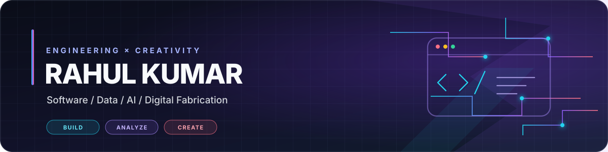

  

 

  

 

<!-- Profile Intro Section with Right-Aligned Avatar -->

## Hi 👋! My name is Rahul Kumar

I am a **Computer Science Lecturer, Project Manager, and Software Developer** specializing in **AI, Python, Data Science, Full-Stack, and Mobile Engineering**. I graduated with a **Bachelor of Computer Applications (BCA)** from **Arka Jain University**, worked with **Thesis Eduventures** and **CodSoft (Data Analytics)**, and train the next generation of developers at **Tinplate Computer Training Centre (TCTC)**.

I build robust software solutions spanning **Flutter/Android mobile apps, high-performance web platforms, and applied AI automation**. Beyond engineering, I am the founder of **Rahnoxa** (3D printing & design) and author psychological suspense fiction within the **Nobi Narrative Universe (NNU)**.

 

---

### 🎉 Congratulations, Team Eazzio!

> 🚀 **Our Eazzio Payroll app is now live on the Google Play Store!**  
>  
> A big thank you to each one of you for your hard work, patience, and dedication. This milestone wouldn’t have been possible without everyone’s efforts and teamwork. Proud of what we’ve achieved together!  
>  
> 📲 **Check it out on Google Play:**  
> 

---

### 🛠️ Languages & Tech Stack

  
  
  
  
  
  
  
  
  
  
  
  
  
  
  
  
  
  
  
  
  
  
  
  
  
  
  

 

---

### 🌐 Connect With Me

  
  
  
  
  
  

 

---

### 📌 Featured Projects & Production Work

<table>
  <tr>
    <td width="50%" valign="top">
      <h3>📱 Eazzio Payroll</h3>
      
<b>Production Workforce Management App (Google Play)</b>

      
Built enterprise attendance, leave tracking, location permissions, real-time payroll calculations, and published the production release on the Play Store.

      

        
        
        
      

      
🔗 <a href="https://play.google.com/store/apps/details?id=com.eazzio.eazziopayroll"><b>Play Store Link</b></a> · <a href="https://github.com/KUmarRahul001/Eazzio-Payroll"><b>GitHub Repo</b></a>

    </td>
    <td width="50%" valign="top">
      <h3>⚡ Nextorra CRM</h3>
      
<b>Enterprise Client Relationship & Workflow Engine</b>

      
Scalable business workflow CRM featuring multi-tenant data pipelines, task tracking, query caching, and dynamic customer analytics.

      

        
        
        
      

      
🔗 <a href="https://github.com/KUmarRahul001/Nextorra"><b>View Repository</b></a>

    </td>
  </tr>
  <tr>
    <td width="50%" valign="top">
      <h3>🤖 ShaktimaanGPT & AI Bots</h3>
      
<b>Custom LLM Agents & Social Automations</b>

      
Intelligent agent workflows using local LLMs (Ollama/Qwen) combined with automated scrapers and scheduled engagement bots.

      

        
        
        
      

      
🔗 <a href="https://github.com/KUmarRahul001/ShaktimaanGpt"><b>ShaktimaanGPT Repo</b></a>

    </td>
    <td width="50%" valign="top">
      <h3>🖨️ CNC Pen Plotter & Rahnoxa 3D</h3>
      
<b>Digital Fabrication & Hardware Engineering</b>

      
Hardware-software plotting machine built with stepper motor controllers, G-code interpreters, and 3D printing custom mechanical parts.

      

        
        
      

      
🔗 <a href="https://rahnoxa.antideploy.com"><b>Rahnoxa Store</b></a> · <a href="https://github.com/KUmarRahul001"><b>CNC Repositories</b></a>

    </td>
  </tr>
</table>

---

### 🐍 Watch my contribution graph get eaten by the snake

<picture>
  <source media="(prefers-color-scheme: dark)" srcset="https://raw.githubusercontent.com/KUmarRahul001/KUmarRahul001/output/github-contribution-grid-snake-dark.svg" />
  <source media="(prefers-color-scheme: light)" srcset="https://raw.githubusercontent.com/KUmarRahul001/KUmarRahul001/output/github-contribution-grid-snake.svg" />
  
</picture>

---

### 📊 GitHub Activity & Statistics

  <table border="0">
    <tr>
      <td align="center">
        
      </td>
      <td align="center">
        
      </td>
    </tr>
    <tr>
      <td colspan="2" align="center">
        
      </td>
    </tr>
  </table>

 

  ✨ <i>"Learn continuously. Build thoughtfully. Ship products that make a difference."</i> ✨

